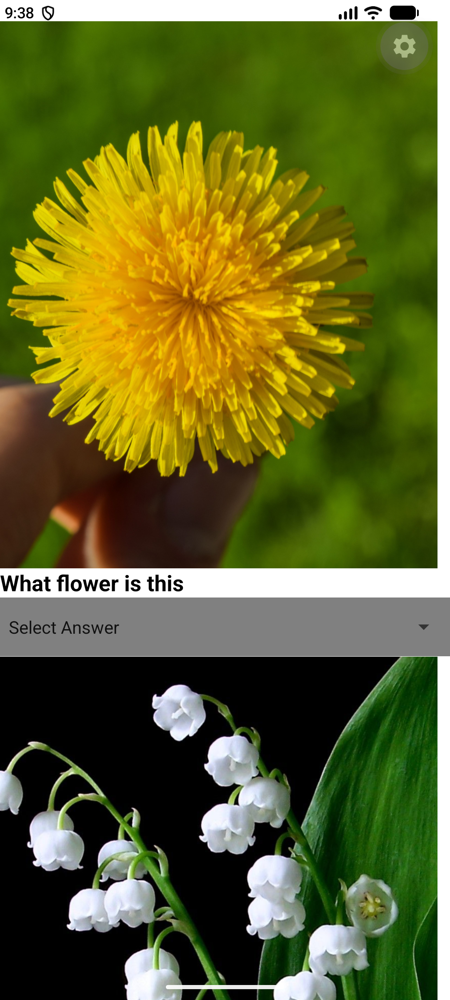
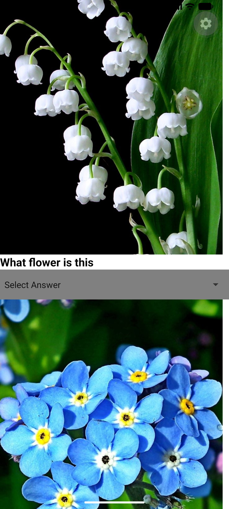
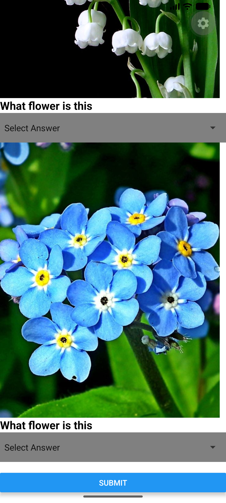

# App Name
L06quiz

This app is a flower quiz app, identify the flower by the images.

# Features Highlight

- Uses a reusable custom component (Quizqns) to display each quiz question.
- Displays flower images for users to identify.
- Uses Picker dropdown menus for multiple-choice answers.
- Validates answers and calculates the final score automatically.
- Prevents users from submitting if any question is unanswered.
- Displays the user's score out of 3 using an alert message. 
- Shows which questions were answered incorrectly.
- Provides different feedback messages based on the user's score using Toast messages.
- Unlocks a special "Fun Fact" section when all questions are answered correctly.

# ScreenShots of App

Screenshots:  

# Demo Video

Demo Video Link:   https://drive.google.com/file/d/16s83sw38ctI90DFiI1acvfUu-1-b1mc4/view?usp=drive_link

